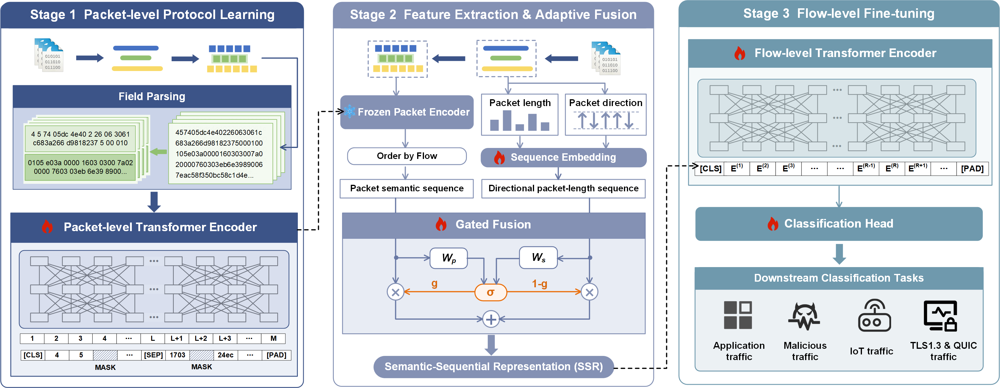

# FLARE

> 📢 **Note:** The paper is currently under review. The complete source code and pre-trained model weights will be released upon acceptance. Stay tuned!

## 📰 News

- **[2026-10]** Repository created. Code and models coming soon.

## 🔍 Overview

<p align="center">
  
</p>
<p align="center"><em>Figure 1. Overall framework of FLARE.</em></p>


### Step 1. Data Processing

#### 1.1 Field Parsing

Extract packet-level fields from raw PCAP files and save them as a TSV file.

```bash
python data_process/rm_finetuning-data_generation.py \
  --pcap-path /path/to/pcap_root \
  --output-file data/packet_fields.tsv \
  --packet-encoding-mode field_ipv4_ipv6_l2safe_app \
  --payload-packet 64 \
  --payload-length 128 \
  --samples-per-class 500 \
  --seed 42
```

#### 1.2 Packet Encoding

Encode each packet with the pre-trained packet encoder, group packets into flows, and split the data into train / validation / test sets (8 : 1 : 1).

```bash
python fine-tuning/preprocess_flow_data_with_time_fixed.py \
  --input_file data/packet_fields.tsv \
  --output_file data/flows_encoded.json \
  --packet_pretrained_model_path "${PACKET_MODEL}" \
  --vocab_path "${PACKET_VOCAB}" \
  --config_path "${MODEL_CONFIG}" \
  --tokenizer bert \
  --embedding word_pos_seg \
  --encoder transformer \
  --seq_length 128 \
  --max_flow_length 64 \
  --min_flow_length 3 \
  --gpu_ids 0 \
  --split \
  --train_ratio 0.8 \
  --val_ratio 0.1 \
  --test_ratio 0.1 \
  --seed 42
```

This step generates `flows_encoded_train.json`, `flows_encoded_val.json` and `flows_encoded_test.json` under `data/`.

### Step 2. Fine-tuning

Train the flow-level temporal classifier.

```bash
python fine-tuning/rm_fine_temporal_classifier.py \
  --train_path data/flows_encoded_train.json \
  --dev_path data/flows_encoded_val.json \
  --test_path data/flows_encoded_test.json \
  --output_model_path model/content_pld.bin \
  --output_dir logs/content_pld \
  --config_path "${MODEL_CONFIG}" \
  --pld_vocab_path "${PLD_VOCAB}" \
  --feature_mode content_pld \
  --max_flow_length 64 \
  --packet_feature_dim 768 \
  --pooling first \
  --epochs_num 50 \
  --batch_size 32 \
  --learning_rate 1e-4 \
  --warmup 0.1 \
  --dropout 0.1 \
  --eval_epochs 1 \
  --early_stopping_patience 10 \
  --early_stopping_metric macro_f1 \
  --save_best_only \
  --gpu_ids 0 \
  --seed 42
```

The best checkpoint (selected by macro-F1 on the validation set) is saved to `model/content_pld.bin`, and training logs are written to `logs/content_pld/`.
